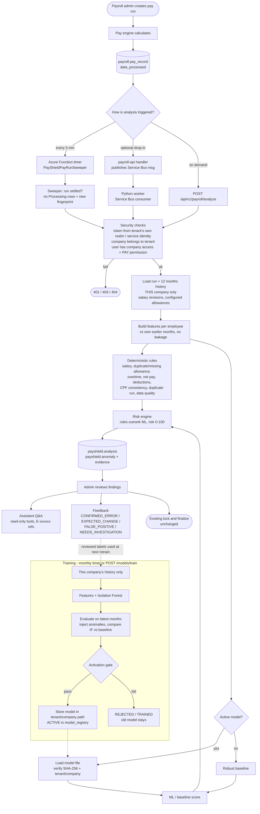

# PayShield AI

Per-company payroll anomaly detection for the Times HR & Payroll SaaS. Advisory only — it never blocks,
modifies, locks or approves payroll. Everything lives in this folder; **no existing repository was changed**.

## Process flow



## Contents
| Path | What |
|---|---|
| `docs/01_TECHNICAL_ASSESSMENT.md` | Analysis of the existing system (tenancy, payroll flow, data, auth, messaging) |
| `docs/ARCHITECTURE.md` | Design contract (features, rules, risk scoring, API, security) |
| `database/migrations/V001__payshield_schema.sql` | New `payshield` schema (tenant DBs + template DB) |
| `database/grants`, `database/tenantstore`, `database/rollback` | Least-privilege `payshield_svc` login, rollback |
| `payshield-ai/` | Python FastAPI service, ML, rules, assistant, worker, tests, Dockerfile |
| `dotnet/` | `Times.PayShield.Client` (IPayShieldService + Service Bus publisher), Functions timers, tests, payroll-api drop-in |
| `deploy/` | Bicep (Container Apps, Blob, Service Bus queue, identities, App Insights) and Azure DevOps pipeline |

## Quick start (local)
```bash
cd payshield-ai
python -m venv .venv && .venv/Scripts/pip install -r requirements-dev.txt
pytest                                   # 48 tests
python scripts/demo_end_to_end.py --port 55433   # needs a local PostgreSQL 16+ on that port (trust auth)
```
The demo builds a tenant store + 2 tenant DBs from the real schema dump, seeds 24 months of synthetic payroll,
trains company A's model, analyses a new run with injected anomalies, and checks tenant isolation.

### Train the first company model
`POST /api/v1/models/train` (headers: `Authorization: Bearer <keycloak token>`, `X-Company-Uid: <company uid>`;
needs PAY **Edit**). Poll `GET /api/v1/models/training-jobs/{jobId}`, then `GET /api/v1/models/status`.
Needs ≥150 observations over ≥6 months; otherwise `INSUFFICIENT_DATA` and analysis uses rules + baseline.

### Run the first payroll analysis
`POST /api/v1/payroll/analyze` with `{"payRunId": "<pay_run.uid>"}` (PAY **View**). Re-posting an unchanged run
returns the same analysis. `GET /api/v1/payroll/runs/{payRunId}/analysis` returns the latest.

Sample response (from the demo, shortened):
```json
{"analysisId":"…","payrollPeriod":"2026-10","status":"COMPLETED","modelVersion":"1.1.0","detector":"ROBUST_BASELINE",
 "mlStatus":"BASELINE_PREFERRED","totalEmployees":60,"flaggedEmployees":8,
 "riskScoreSemantics":"riskScore 0-100 is a priority rank … NOT a probability of error …",
 "anomalies":[{"employeeNo":"E00003","anomalyType":"UNUSUAL_SALARY_INCREASE","source":"RULE","ruleId":"SAL-001",
   "severity":"CRITICAL","riskScore":95,"currentValue":7820.0,"expectedValue":5210.0,"expectedMethod":"median_12_periods",
   "changePct":50.1,"description":"Basic salary increased 50.1% from 5,210.00 to 7,820.00 with no salary revision effective in 2026-10.",
   "recommendedAction":"Verify an approved salary revision exists or correct the contract salary.",
   "evidence":[{"kind":"pay_record","ref":"…"},{"kind":"history","ref":"2026-09","detail":{"basic_contractual":5210.0}}]}]}
```

## API
| Method | Path | Permission |
|---|---|---|
| POST | `/api/v1/models/train` | Edit |
| GET | `/api/v1/models/status`, `/models/versions`, `/models/training-jobs/{id}` | View |
| POST | `/api/v1/models/{modelId}/activate` (rollback) | Edit |
| POST | `/api/v1/payroll/analyze` | View |
| GET | `/api/v1/payroll/analysis/{id}`, `/payroll/runs/{payRunId}/analysis` | View |
| POST | `/api/v1/payroll/feedback` `{anomalyId, outcome, comment}` | Edit (users only) |
| POST | `/api/v1/assistant/ask` `{question, analysisId}` | View |
| POST | `/api/v1/internal/sweep`, `/internal/retraining` | Service identity only |
Errors are `application/problem+json` with a `code`. Other companies' ids return 404 (existence is never revealed).

## Model evaluation (synthetic data — not a production accuracy claim)
Company A: 1,179 training observations (2025-01 → 2026-09); validation = last 5 months, 300 clean rows + 1,500 injected anomalies.

| Detector | ROC-AUC | Recall at alert | Clean alert rate |
|---|---|---|---|
| Robust baseline | 0.98 | **0.87** | 0.00 |
| Isolation Forest | 0.93 | 0.23 | 0.00 |

The baseline won and was selected automatically (`detector=ROBUST_BASELINE`). Isolation Forest is kept and
re-evaluated at every retrain; it will only be used when it beats the baseline on that company's data.
Demo run: all 7 injected scenarios (A–G) were detected; the approved promotion was not flagged as an error;
no normal employee got a HIGH finding.

## Security summary
Tenant comes only from a verified token (issuer must equal that tenant's Keycloak realm) or an allow-listed
Entra service identity; company must belong to the tenant; PAY View/Edit checked with
`security.get_permissions_for_principle_on_resource`; models stored under tenant/company paths with SHA-256
verification and a tenant-keyed cache; the DB login can read payroll but never modify it (verified);
logs use an allow-list (no payroll values); the assistant has no write tools and refuses write requests.

## Known gaps (not done)
- Employee-level **Data Security** (Times.AccessFilter.Engine port): users with PAY View currently see every employee of the company.
- **Overtime**: payroll has no OT data; detection works only after configuring `payshield.company_setting.overtime_pay_codes`.
- **Salary revisions have no approval state** in the product; "approved" = a career_progression row exists before the run.
- Azure OpenAI path is implemented but not exercised against a real deployment (deterministic fallback is tested).
- Bicep and pipeline were not validated (no Azure CLI here); payroll-api drop-in handler is not compiled — check the repository name noted in it.
- No Angular UI (would require changing times-portal-ui).
